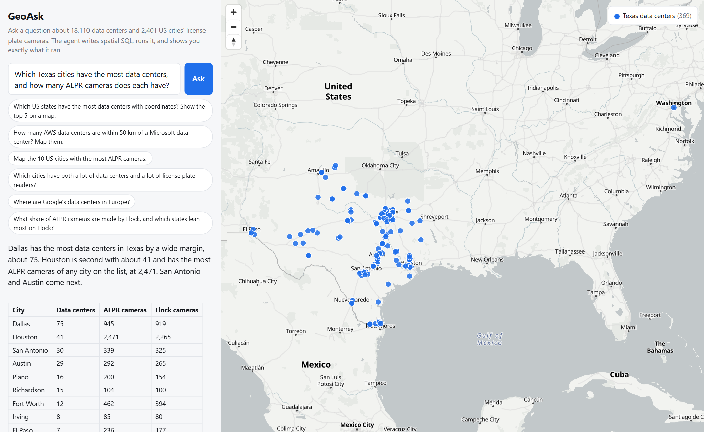

# GeoAsk — ask a map a question, get a checkable answer

GeoAsk is an LLM agent that answers plain-English questions about geospatial data by
writing spatial SQL, running it against a read-only DuckDB database, and showing you
exactly what it ran. Every number in the answer traces back to a query you can see.

**Live demo:** _(coming)_ · **Stack:** Python · DuckDB spatial · Claude API (tool use) · FastAPI · MapLibre



## What it does

> *"How many AWS data centers are within 50 km of a Microsoft data center? Map them."*

1. The agent reads the schema, then writes a `ST_Distance_Sphere` self-join.
2. The query runs against DuckDB (read-only, 2,000-row cap, 20 s budget).
3. It calls `show_on_map` with a second query; the rows become a MapLibre layer.
4. The answer comes back with the numbers, a one-line caveat about data quality,
   and an expandable trace of every SQL statement, row count, and preview.

Questions the data can't answer ("total megawatts in Virginia?") get a plain
"the data doesn't have that" instead of a made-up figure — this is tested in the eval.

## Data

| Table | Rows | Source |
|---|---|---|
| `datacenters` | 18,110 facilities, 4,182 operators, 6,131 with coordinates | [Global Data Center Map](https://github.com/Ringmast4r/Global-Data-Center-Map) (Ringmast4r) |
| `alpr_cities` | 2,401 US cities with license-plate-reader counts by vendor | [Finding Flock](https://www.findingflock.com) / OpenStreetMap (ODbL) |

The ETL ([`etl/build_db.py`](etl/build_db.py)) does the unglamorous part: the raw
`state` column mixes `TX`, `Texas`, and city names like `Phoenix`; operators appear
as `Amazon`, `Amazon AWS`, and `AWS`. Both get normalized into `state_code` and
`operator` so the agent's queries don't silently miss a third of the rows. Only a
third of facilities have coordinates, so the agent is told to filter on `has_coords`
and to say how many rows were excluded.

## Evaluation

[`eval/cases.json`](eval/cases.json) holds 20 questions with gold answers. Gold
values are computed from the database at run time, so the eval stays valid if the
data is rebuilt. Checks cover: the right number appears in the answer (with
tolerance for percentages), the right entity is named, a map layer is produced
when asked for (and with the right feature count), and unanswerable questions are
declined rather than guessed.

```
python eval/run_eval.py
```

_(results table filled in below after the first full run)_

## Run it

```bash
python -m venv .venv && .venv/Scripts/activate      # or source .venv/bin/activate
pip install -r requirements.txt
python etl/build_db.py --raw data/raw               # builds data/geoask.duckdb
export ANTHROPIC_API_KEY=sk-ant-...
uvicorn app:app --reload                            # http://127.0.0.1:8000
```

CLI:

```bash
python -m geoask.cli "Which US state has the most data centers with coordinates?"
```

Tests (no API key needed):

```bash
pytest
```

## Design notes

- **Read-only by construction.** [`geoask/db.py`](geoask/db.py) accepts one `SELECT`/`WITH`
  statement, rejects DDL/DML/`ATTACH`/`COPY`/`INSTALL`, caps rows, and interrupts
  long queries. The model never gets a write path.
- **Manual tool loop, not a framework.** [`geoask/agent.py`](geoask/agent.py) is ~200 lines.
  Three tools (`get_schema`, `run_sql`, `show_on_map`), strict JSON schemas, and
  a `Step` record for each call so the UI can show the trace. Failed SQL goes back
  to the model as an `is_error` tool result and it retries.
- **The model does the SQL; the code does the geometry.** Geometry columns are
  serialized to GeoJSON by DuckDB (`ST_AsGeoJSON`), never by the model.
- **Prompt caching.** The system prompt and tool definitions are the stable prefix;
  the question comes last.
- **Model:** `claude-opus-5-5` with adaptive thinking at medium effort. A typical
  question costs ~10k input / ~1k output tokens and takes 10–40 s.

## Attribution

Data centers © Ringmast4r — Global-Data-Center-Map. Camera locations © OpenStreetMap
contributors (ODbL), compiled by Finding Flock. Basemap © OpenFreeMap / OpenStreetMap.
See [`data/raw/ATTRIBUTION.md`](data/raw/ATTRIBUTION.md).
